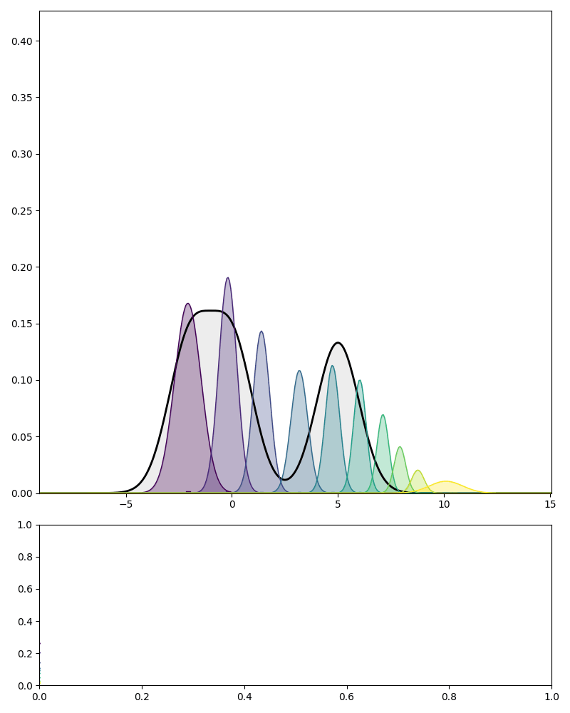
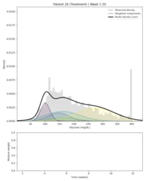

# Longitudinal Gaussian mixtures and Neural ODEs

Research code for fitting a shared Gaussian mixture dictionary by maximum
mean discrepancy (MMD), followed by participant-specific neural ODEs for
the time-varying mixture weights. Includes PEDAP glucose-monitoring data
analyses and synthetic experiments.

<p align="center">
  <table>
  <tr>
    <td align="center" width="50%">
      <a href="assets/distribution_evolution.gif">
        
      </a>
      <p><em>Synthetic example: Gaussian components and mixture-weight trajectories.</em></p>
    </td>
    <td align="center" width="50%">
      <a href="assets/patient_26.gif">
        
      </a>
      <p><em>Real-data example (Patient 26): observed glucose distribution and fitted mixture evolution.</em></p>
    </td>
  </tr>
</table>
</p>

## How the model works

The input is a sequence of samples collected at observation times. Rather
than fitting an unrelated density at each time, the model uses a shared
dictionary of Gaussian components:

$$
f_t(x)=\sum_{k=1}^{K}\alpha_k(t)\,\mathcal{N}(x\mid m_k,\Sigma_k).
$$

The component means and covariances stay fixed over time; the mixture
weights describe how the distribution changes. In the clinical application,
the dictionary is also shared across participants, while each participant
has their own weight trajectory.

Fitting has two stages:

1. **Fit the distributions at the observed times.** Maximum mean discrepancy
   (MMD), with a Gaussian kernel, compares each empirical sample with its
   Gaussian mixture. The dictionary and local weights are fitted by
   alternating optimization; with the dictionary fixed, the regularized
   weight problem is a quadratic program on the probability simplex.
2. **Learn continuous-time weight trajectories.** A neural ODE evolves a
   latent state, which is mapped to valid mixture weights by a softmax:

$$
\frac{d u(t)}{dt}=v_\phi(u(t),t),
\qquad \alpha(t)=\operatorname{softmax}(u(t)).
$$

The ODE is trained against the locally fitted weights. It provides a smooth
representation between observation times, from which densities, means and
covariances can be evaluated. In the CGM examples, observations are weekly
samples of glucose alone or of glucose together with its rate of change.

## Setup

```bash
pip install -r requirements.txt
```

Reading the clinical Parquet files also requires a pandas-compatible
Parquet engine, such as `pyarrow`.

## Data

`PEDAP_benchmark.zip` contains the three original source files used in the
analysis and every processed part, including the aggregated distributions the
model is fitted on. It is distributed separately from the code. See [PEDAP_descripcion_datos.txt](PEDAP_descripcion_datos.txt)
for their contents and processing rules.

Extract the single benchmark folder into `data/processed/`:

```text
data/processed/
  pedap_benchmark/
    README.txt
    raw/                          # Three original input files
    rct_followup/                 # Randomized-phase follow-up
    pre_randomization_baseline/   # 14 days before randomization
    weekly_distributions/         # The aggregated distributions the model fits
```

All three parts belong to the same benchmark and use the same participant IDs.
The follow-up is used for longitudinal fitting; the baseline anchors changes
relative to the pre-randomization period. Each part retains its processing
manifest and fingerprint.

`rct_followup/` and `pre_randomization_baseline/` hold one row per sensor
reading: the auditable record. `weekly_distributions/` holds what the model
actually consumes, in long form — the same readings already split into the
weekly blocks `X_t`, at the real observation times, plus the single
pre-randomization block. Univariate and bivariate are separate files rather
than one table with an optional column: d=1 keeps every reading in a block,
while d=2 keeps only the interior centres with genuinely adjacent five-minute
neighbours, so d=2 is a strict subset on different points. There is no separate
index table: block structure comes from grouping on `(PtID, nominal_week_index)`
and each block's coverage from `pedap_weekly_qc.csv` on the same key. The
bivariate tables carry `UsesImputedNeighbour` per point, so the "exclude
HIGH/LOW derivatives" sensitivity is a row filter.

To rebuild from the original files included in the ZIP, run:

```bash
python scripts/build_pedap_dataset.py --raw-dir data/processed/pedap_benchmark/raw
python scripts/build_pedap_baseline_dataset.py --raw-dir data/processed/pedap_benchmark/raw
python scripts/build_pedap_distributions.py --force
```

The third script re-derives the distributions from the first two. It does not
restate a single convention: it calls `load.load_patient_weeks` and
`Analysis.baseline_projection.baseline_points`, and checks every block it
writes against those arrays before saving, so the artefact cannot drift from
the code path the fits use.

## Run

```bash
python main.py --analysis-mode cgm_univariate
python main.py --analysis-mode cgm_bivariate
python main.py --analysis-mode synthetic_d1
python main.py --analysis-mode synthetic_d10
```

Clinical analyses use the PEDAP RCT dataset.
Model settings are in `input.py`. Clinical fits use five shared components
and participant-specific weight trajectories. Compatible saved fits may be
reused; fitting can be computationally expensive.

## Code structure

- `Core/`, `Run/`, `Utils/`: estimation, training and numerical evaluation.
- `Visualization/`: plotting and experiment logging.
- `PEDAP/`: the single authoritative implementation of every PEDAP/SAP
  convention (follow-up window, HIGH/LOW imputation, weekly blocks, the
  72-hour rule, the dataset fingerprint), with no dependency on the modelling
  code. `scripts/build_pedap_*.py`: the dataset builders that apply them.
- `load.py`: processed-data loading and weekly observations.
- `Analysis/`: clinical summaries, inference and figures;
  `Medical_DataAnalysis.ipynb` provides the analysis notebook.

`Core/test_mmd.py` and `Utils/test_utils.py` contain numerical evaluation
functions used by the experiments and plots; they are part of the code.

## Outputs

Fitted parameters and trajectories are saved under `Results_paper/`.
The analysis notebook writes its figures to `figures_paper/`, organized by
representation and experiment. PDF files for manuscripts
and PNG previews are kept together, without a separate export copy.
Select your saved experiment in the notebook before running the analyses.

Datasets, fitted results, generated figures and shareable archives
(`exports/`) are excluded from Git. Documentation illustrations in `assets/`
are included so that the README renders on GitHub.

The longitudinal dataset uses Dexcom Clarity, from randomization + 4 days
to the actual Week 13 visit. Usable weeks require 72 hours; missing weeks
remain missing and observation times stay on the clinical timeline.
Clinical fits retain K=5, the existing ridge and degree-4 polynomial NODE.

Descriptive group curves average only participants whose fitted support
contains each time and save the arm-specific counts. Functional inference
uses a fixed cohort on the widest interval covered by at least 90% of each
arm, chosen solely from supports and treatment labels (85% and 95%
sensitivities). Curves are never extrapolated. The two estimands are absolute
weights and change from a valid pre-randomization baseline, projected onto
the same dictionary with the participant's bandwidth and ridge.

The separate descriptive clinical endpoint compares baseline with pooled
13-week follow-up, requiring 168 hours in both periods and complete cases.

The notebook writes paper figures to `figures_paper/<dimension>/<run>/`.
Run `python -m Analysis.export_figures` to package the active d1/d2 figures.
Historical illustrative NODE sensitivity figures remain in
`figures_paper/sensitivity/`, with their provenance; they are separate from
the primary clinical export. Historical artifacts in `legacy/` are inactive
and excluded from version control. Run checks with `python -m pytest`.

## License

MIT. See [LICENSE](LICENSE).

The PEDAP data are not covered by it: they come from the Jaeb Center for
Health Research and are distributed separately under their own terms.
